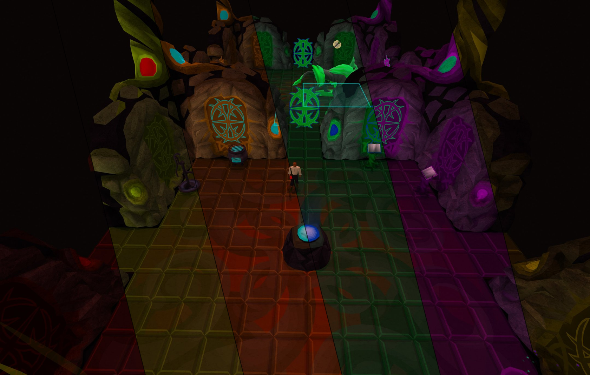

# CG Recolor Plugin

Welcome to the **CG Recolor** plugin! This plugin allows you to customize and enhance your experience in the Corrupted Gauntlet by providing various recoloring options.

## NEW: 117 HD support and experimental features by Marts

[Take me to the section](#117-hd-support-by-marts)

## Configuration

Access the plugin configuration through the RuneLite settings panel. Here are the available options:

### Primary Color

Choose your desired primary color for the Corrupted Gauntlet elements.

### Secondary Color

Select a secondary color to complement the primary color. This option can be toggled on or off.

### Random Color Mode

- **Enable**: Colors will be randomized for each run.
- **Disable and Re-enable**: Toggle this option off and then on again to re-randomize the colors.

### NPC Recoloring

Enable this option to apply the chosen colors to NPCs within the Corrupted Gauntlet.

### Projectile Recoloring

Enable this option to customize the color of projectiles.

### Damaging Floor Recoloring

Enable this option to recolor the damaging floor. Note that turning this on can reduce visibility, so use it with caution.

### Tornado Recoloring

Enable this option to change the color of the Hunllef's tornadoes.

### Harmonize colors

Enable this option for a more unified color scheme.

## 117 HD support by [Marts](https://github.com/Martsssssss)

117 HD gives the corrupted NPCs and many of the objects in the Corrupted Gauntlet a bright red glow. These glows are built into 117 HD and ignore any recolour, so a blue Gauntlet would still glow red.

With **Pause 117 HD lights in CG** on (the default), this plugin turns off 117 HD's **NPC lights** and **Object lights** while you're inside the Corrupted Gauntlet, then puts your own 117 HD settings back as soon as you leave. Your settings are remembered even if the client closes while you're inside, and are put back the next time you log in outside the Gauntlet.

This plugin only changes those two 117 HD settings, and only while you're inside the Corrupted Gauntlet. If you don't use 117 HD, it does nothing.

## Experimental feature by [Marts](https://github.com/Martsssssss)

- **Better random colours:** random mode picks one of the game's 63 different hues, spread evenly, with strong saturation. Without it, random mode picks any colour at all, which often comes out greyish and makes many runs look alike.
- **Min. secondary hue gap:** with better random colours, how far apart the main and secondary colours must be, so you never get two that look nearly the same.
- **Avoid recent colours:** with better random colours, won't pick a colour close to any of your last few runs.
- **Vary saturation & brightness:** normally only the hue of your colour is used on most surfaces. This also carries over some of its saturation and brightness, so a pale, a vivid and a dark version of the same colour all look different. **Tone strength** sets how strongly. The damaging floor is left alone.

For the most variety, turn on **Random color each run**, **Use secondary color**, **Better random colours** and **Vary saturation & brightness**, and turn off **Harmonize colors**.

## Credits

Credit for the 117 HD compatibility, the experimental features, and the write-up (including screenshots) of the new features goes to [Marts]((https://github.com/Martsssssss)).

## Issues and Support

If you have any issues or questions about the CG Recolor plugin, please submit an issue on the plugin's GitHub repository or send me a DM on Discord. My Discord-username is "tegritaet".
